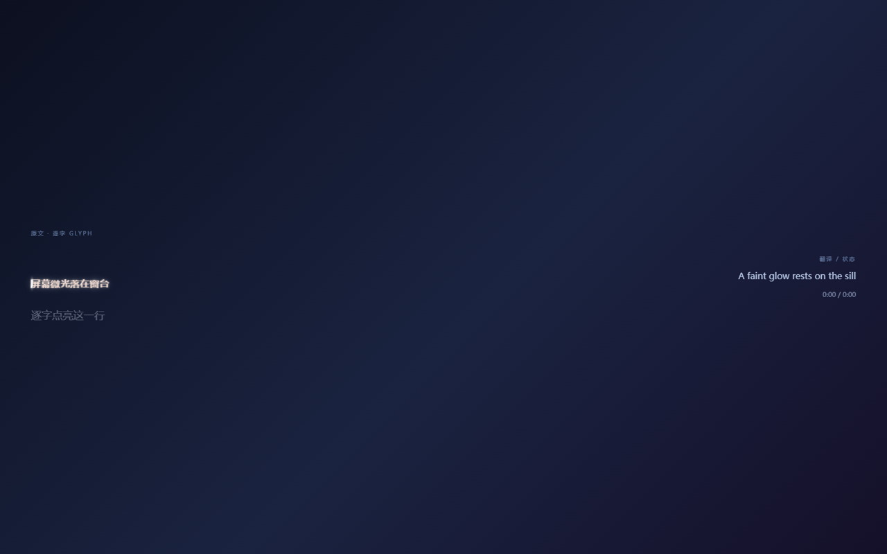

<div align="center">


# GlassLyrics

**把液态玻璃歌词，搬进任何游戏。** Windows · macOS · Linux

QQ 音乐 · 网易云音乐 · 酷狗音乐 · 汽水音乐 · Apple Music · Spotify

[](https://github.com/Napart7/Music-and-game/releases)
[](LICENSE)
[](#%E5%B9%B3%E5%8F%B0%E6%94%AF%E6%8C%81)
[](#)
[](#%E5%90%88%E8%A7%84%E4%B8%8E%E9%9A%90%E7%A7%81)

[下载安装包](https://github.com/Napart7/Music-and-game/releases) · [使用说明](docs/使用说明.md) · [平台适配](docs/平台适配.md) · [跨平台适配](docs/跨平台适配.md) · [性能自检](docs/性能自检-v1.3.md)

</div>

---

## 这是什么

GlassLyrics 是一个**独立透明置顶窗口**，把 DangoMusic 那种液态玻璃、逐字扫光、动态漂浮的歌词观感，覆盖到**任意游戏**画面上（Windows / macOS / Linux）——不注入游戏、不读内存、不抓音频，只用系统自带的媒体接口读「谁在放歌」。

- **中央永远留空**：歌词在画面左右两侧，准星区域一根线都不挡
- **自动贴合游戏窗口**：切窗口、改分辨率、换显示器，歌词跟着走（实测误差 1px）
- **零配置读歌**：六个平台的播放状态与播放控制，开箱即用
- **真逐字**：网易云 YRC 原生逐字时间轴；其他平台整行 LRC + 推算，界面如实标注，不冒充

> 想改成自己的样子？全局热键、歌词位置、字号字重、辉光颜色、漂浮行数全都能调，配置存本机。

---

## 效果

<div align="center">

<br><sub>Warframe 实机：歌词浮在画面两侧，中央视野完全留空</sub>
</div>

<table>
<tr>
<td width="50%" align="center"><br><sub>液态玻璃主菜单 · 七个分区</sub></td>
<td width="50%" align="center"><br><sub>辉光由字形发散 · 无矩形底板</sub></td>
</tr>
<tr>
<td align="center"><br><sub>自捕捉游戏窗口并跟随</sub></td>
<td align="center"><br><sub>平台歌词源 · 逐字扫光</sub></td>
</tr>
</table>

---

## 平台支持

| | Windows 10/11 | macOS 12+ | Linux（X11） | Linux（Wayland） |
|---|---|---|---|---|
| 读歌 / 控播 | ✅ SMTC | ✅ Music / Spotify | ✅ MPRIS | ✅ MPRIS |
| 跟随游戏窗口 | ✅ Win32 | ✅ 需辅助功能权限 | ✅ xdotool | ⬜ 系统限制，退整屏 |
| 透明置顶 / 热键 | ✅ | ✅ | ✅ 需合成器 | 🟡 取决于桌面 |

**Linux 依赖**：`playerctl`（读歌/控播）、`xdotool` + `xprop`（窗口跟随）。
Debian/Ubuntu：`sudo apt install playerctl xdotool x11-utils`；缺少时其余功能照常，只是退回整屏。
**macOS**：首次运行请允许「辅助功能」与「自动化」权限；未签名版本需右键「打开」。
完整差异、验证步骤与限制见 **[docs/跨平台适配.md](docs/跨平台适配.md)**。

## 支持的播放器

| 平台 | 读歌 / 控制 | 歌词源 | 逐字 | 选歌搜索 |
|---|---|---|---|---|
| **QQ 音乐** | ✅ SMTC | ✅ LRC + 翻译 | 推算 | ✅ |
| **网易云音乐** | ✅ SMTC | ✅ **YRC 逐字** + 翻译 | **原生** | ✅ |
| **酷狗音乐** | ✅ SMTC | ✅ LRC | 推算 | ✅ |
| **汽水音乐** | ✅ SMTC | 🟡 同曲匹配 | 推算 | 🟡 经网易云 |
| **Apple Music** | ✅ SMTC | 🟡 同曲匹配 + iTunes 元数据 | 推算 | ✅ iTunes 目录 |
| **Spotify** | ✅ SMTC | 🟡 同曲匹配（LRCLIB 优先） | 推算 | ✅ 需自备开发者凭据 |

「同曲匹配」= 用曲名 + 歌手在中文平台和 LRCLIB 找同一首歌的歌词，**不是平台官方歌词**。完整矩阵、认证方式、兼容性处理见 **[docs/平台适配.md](docs/平台适配.md)**。

---

## 功能清单

<table>
<tr><td width="33%" valign="top">

**歌词**
- 网易云 YRC 真逐字
- QQ / 酷狗 LRC + 翻译
- 制作信息自动过滤
- 时间轴偏移校准
- 本地缓存（上限 300 条）

</td><td width="33%" valign="top">

**视觉**
- 液态玻璃主菜单
- 字形发散辉光（四色可调）
- 逐字弹跳 / 摆动 / 砸入
- 漂浮歌词 3–6 行，每行独立漂移
- 左右双侧 / 居中 / 单侧布局

</td><td width="33%" valign="top">

**交互**
- 全部 8 个热键可自定义
- 歌词自由拖动定位
- 侧栏宽 / 行距 / 字重 / 透明度
- 点击穿透（四重保险）
- 托盘菜单 / 开机自启开关

</td></tr>
<tr><td valign="top">

**平台**
- 六平台 SMTC 读取 + 控制
- 六平台选歌搜索
- 专辑封面显示
- 一键唤起客户端搜索

</td><td valign="top">

**性能**
- 切歌出歌词 221ms（并行竞速）
- 全场景 60fps / 0 掉帧
- 暂停零重绘、扫光量化
- 低配模式（30 帧 + 辉光减层）

</td><td valign="top">

**安全**
- 不注入游戏进程
- 不读游戏内存
- 不抓音频 / 不破 DRM
- 不内置任何账号凭据

</td></tr>
</table>

---

## 30 秒上手

1. **下载** → [Releases](https://github.com/Napart7/Music-and-game/releases)（三平台产物由 CI 构建）

   | 平台 | 文件 |
   |---|---|
   | Windows | `GlassLyrics.Setup.x.y.z.exe`（安装版）· `GlassLyrics-Portable.exe`（绿色版） |
   | macOS | `GlassLyrics-x.y.z-arm64.dmg`（Apple 芯片）· `GlassLyrics-x.y.z.dmg`（Intel） |
   | Linux | `GlassLyrics-x.y.z.AppImage` · `glasslyrics_x.y.z_amd64.deb` |

2. **播放** → 打开 QQ 音乐 / 网易云 / 酷狗 / 汽水 / Apple Music / Spotify 放一首歌
3. **进游戏** → 歌词自动浮在画面两侧；独占全屏请改成「无边框全屏」
4. **需要设置** → `Ctrl + Alt + P` 唤出液态玻璃主菜单

| 默认热键 | 动作 |
|---|---|
| `Ctrl + Alt + P` | 打开 / 收起主菜单 |
| `Ctrl + Alt + H` | 显示 / 隐藏歌词 |
| `Ctrl + Alt + B` | 切换布局 |
| `Ctrl + Alt + F` | 开关窗口自适应 |
| `Ctrl + Shift + Alt + Q` | 退出 |

> 全部热键可在「通用」页点击重绑定；播放控制热键默认空，需要就设。

---

## 常见问题

<details>
<summary><b>游戏里看不到歌词？</b></summary>

99% 是**独占全屏**（Exclusive Fullscreen）。任何普通置顶窗口在独占全屏下都不可见，请在游戏里改成「无边框全屏 / 窗口化全屏」。
</details>

<details>
<summary><b>切屏出去再回游戏，点不动游戏？</b></summary>

v0.9.1 起已修：失焦自动收起菜单、点面板外立即关闭、拖动模式点空白退出、2 秒心跳重申穿透。若仍遇到，按一下 `Ctrl+Alt+H` 隐藏再显示即可恢复。
</details>

<details>
<summary><b>Spotify 搜索提示需要凭据？</b></summary>

Spotify 官方不提供歌词接口，搜索需要你自己的开发者 App：developer.spotify.com → Create app → 复制 Client ID / Secret → 填进「通用 → Spotify 开发者凭据」。凭据只存本机，不随仓库分发。播放控制不需要凭据。
</details>

<details>
<summary><b>汽水音乐 / Apple Music 的歌词是官方的吗？</b></summary>

不是。这两个平台没有公开歌词接口，程序会用**同曲匹配**去网易云 / QQ / 酷狗 / LRCLIB 找同一首歌的歌词，界面会标注来源。中文歌命中率很高，冷门歌可能找不到。
</details>

<details>
<summary><b>会被反作弊检测吗？</b></summary>

GlassLyrics 不注入、不挂钩子、不读写游戏内存，对游戏而言只是一层普通置顶窗口。但**带反作弊的联机游戏请自行判断**是否使用覆盖层，风险自负。
</details>

更多问题见 [docs/使用说明.md](docs/使用说明.md)。

---

## 技术架构

```
┌─────────────────────────────── Electron 主进程 ───────────────────────────────┐
│  透明置顶窗 (transparent + alwaysOnTop)    全局热键 / 托盘 / 配置持久化          │
│         │                                        │                            │
│   SMTC 桥接脚本 ──► 曲目·进度·播放状态 ◄── 播放控制指令                        │
│         │                                        │                            │
│   窗口探针（400ms）──► 前台游戏矩形（DPI 感知）    │                            │
│         │                                        │                            │
│   歌词引擎：QQ / 网易云(YRC) / 酷狗 / LRCLIB ── 同曲匹配 + 缓存 + 降级          │
└───────────────────────────────────┬───────────────────────────────────────────┘
                                    │ IPC（contextIsolation）
┌───────────────────────────────────▼───────────────────────────────────────────┐
│  渲染层：逐字 Glyph · 扫光 · 字形辉光 · 漂浮歌词 · 液态玻璃菜单 · 拖动定位        │
│  性能：变化检测跳写 · 扫光量化 · 帧率上限 · 合成器动画（JS 零逐帧）              │
└───────────────────────────────────────────────────────────────────────────────┘
```

- **读歌不碰播放器**：Windows 用 WinRT SMTC、macOS 用 AppleScript、Linux 用 MPRIS（playerctl），全是系统级接口，无第三方 SDK
- **贴合不碰游戏**：只读前台窗口的 HWND 矩形（`GetForegroundWindow` / `DwmGetWindowAttribute`），不打开游戏进程
- **歌词不落盘**：运行时从公开接口拉文本，缓存在本机，仓库与安装包不含任何歌词数据

---

## 开发与构建

```bash
cd app
npm install                 # 首次
npm start                   # 开发运行

npm run dist                # 打包（NSIS 安装包 + 便携 exe → ../dist）
```

**回归测试**（无需 Electron，headless Edge + CDP）：

```bash
node tools/check_compliance.mjs   # 跨平台门禁：文件 / 敏感信息 / 语法 / .sh 换行符
node tools/verify_backends.mjs    # 17 项：三端后端契约（媒体 / 窗口 / 路由）
node tools/verify_providers.mjs   # 36 项：解析 / 清洗 / 平台识别 / 降级
node tools/verify_lyrics.mjs       # 19 项：歌词引擎 / 缓存
node tools/verify_menu.mjs         # 56 项：菜单 / 辉光 / 热键 / 拖动 / 漂浮 / 性能
node tools/verify_autofit.mjs      # 22 项：窗口自适应
node tools/verify_preview.mjs      # 29 项：预览页
```

发版：改 `app/package.json` 版本 → `git tag vX.Y.Z` → push tag，GitHub Actions 会自动构建并发布 Release。

---

## 目录结构

```
app/                 Electron 主程序
  main.js            主进程：窗口 / 热键 / SMTC / 自适应 / 点击穿透状态机
  lyrics.js          歌词引擎：源优先级 / 缓存 / 降级
  providers.js       QQ / 网易云(YRC) / 酷狗 / LRCLIB / iTunes / Spotify
  backends/          平台后端：路由 + 统一契约 + win/mac/linux 脚本
  renderer/          渲染层（单文件：歌词 / 菜单 / 交互）
  *.ps1              Windows：SMTC 桥接、播放控制、窗口探针
docs/                文档与实机截图、自检 JSON
tools/               回归测试与验证脚本
```

---

## 合规与隐私

- 不注入任何进程、不读取游戏内存、不模拟全局按键、不抓取音频
- 不破解 KRC / QRC 等加密歌词，不下载歌曲、不绕过 DRM
- Spotify 凭据由用户自备，仅存本机 `config.json`，仓库不内置任何凭据
- 歌词文本仅在运行时从公开接口获取并缓存在用户本机；仓库与安装包**不含任何歌词**
- 视觉参数参考 DangoMusic（GPL-3.0）的公开渲染规格描述，**未拷贝其代码、着色器或素材**
- 详见 [docs/第三方声明.md](docs/第三方声明.md)

## License

[MIT](LICENSE) © GlassLyrics contributors

<div align="center"><sub>如果这个项目让你在游戏里听歌更爽，点个 Star 就是最大的支持</sub></div>
