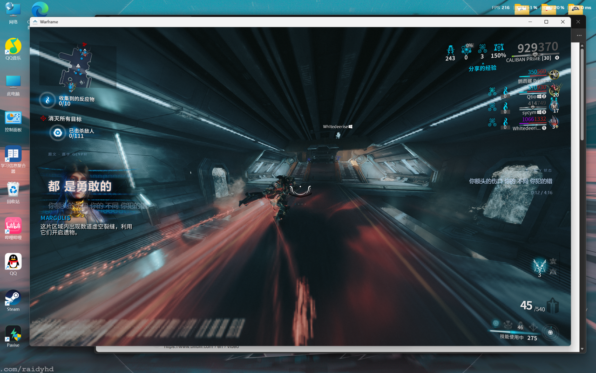

# GlassLyrics · 游戏内歌词覆盖层

在任何游戏画面上显示逐字歌词与液态玻璃主菜单。**不修改游戏、不注入进程、不读取游戏内存。**

> 当前状态：**v0.7 正式版可用**。新增专辑封面显示（取自平台公开 CDN）。QQ 音乐 / 网易云音乐双平台适配、网易云 YRC **真实逐字**时间轴、液态玻璃主菜单、字形发散辉光（无方框）、自捕捉游戏窗口自适应、透明置顶覆盖层、热键、托盘、开机自启开关、播放控制全部可用。项目名暂定，可改。



## 它解决什么问题

Minecraft 模组 DangoMusic 有液态玻璃播放器、逐字歌词、动态岛和歌曲卡片，但它长在 MC 1.20.1 Forge 的渲染循环里，别的游戏用不了。GlassLyrics 把这套观感搬到 Windows 上一个独立透明置顶窗口，覆盖到任意游戏画面上。

## 功能状态（v0.7）

| 功能 | 状态 |
|---|---|
| 跟随 QQ 音乐 / 网易云正在播放的歌（SMTC） | ✅ 已实现，自动识别播放器平台 |
| **QQ 音乐歌词源**（搜索 + LRC + 翻译） | ✅ 已实现，实测《孤勇者》54 行，制作信息自动过滤 |
| **网易云音乐歌词源**（搜索 + LRC + **YRC 真逐字** + 翻译） | ✅ 已实现，实测《孤勇者》52 行真实逐字 |
| **自动质量优先**：QQ 音乐播放也会尝试网易云 YRC | ✅ 已实现，拿到真逐字就升级；手动锁定源则尊重选择 |
| 透明置顶覆盖层 + 真实游戏画面叠加 | ✅ 已实现，像素判定 `P0_PASS: true` |
| **液态玻璃主菜单**（6 个分区、侧边导航） | ✅ 已实现，`Ctrl+Alt+P` 唤出 |
| **字形发散辉光**（无矩形方框） | ✅ 已实现，四色 / 强度 / 半径 / 字号可调 |
| 逐字 Glyph、暖白 `#F7E1D7`、黑描边、逐字弹跳摆动砸入 | ✅ 已实现 |
| 左右双侧布局、中央 30% 留空不挡准星 | ✅ 已实现，4 种布局可切 |
| 全局热键、鼠标穿透切换、托盘菜单 | ✅ 已实现（托盘含歌词源子菜单） |
| 开机自启开关（默认关，用户自己选） | ✅ 已实现，配置持久化 |
| 播放 / 暂停 / 上一首 / 下一首 | ✅ 已实现，通过 SMTC 控制 |
| 进度条、平台显示、歌词源与逐字精度显示 | ✅ 已实现 |
| **专辑封面显示**（主菜单「正在播放」卡片） | ✅ 已实现，封面取自同平台公开 CDN（QQ 300×300 / 网易云 300px 缩略），无封面或加载失败自动回落占位符 |
| **自捕捉前台游戏窗口并跟随窗口矩形** | ✅ 已实现，实测贴合误差 1px |
| **按窗口尺寸自适应字号 / 侧栏 / 中央留区** | ✅ 已实现 |
| 时间轴偏移校准、翻译开关、排除名单、多显示器 | ✅ 已实现 |
| 本地缓存 / 曲名清洗 / 失败自动降级 | ✅ 已实现（缓存带版本，升级后自动重拉） |
| NSIS 安装包 + 绿色便携 exe | ✅ 见 `dist/` |
| 歌单 / 搜索、双窗口拆分（面板期间仍穿透） | ⏳ 二期 |
| 一起听 | **不做** |
| 真 3D 世界空间歌词 | **做不到**，用双侧布局 + 伪 3D 透视替代 |

## 主菜单（v0.6+）

`Ctrl+Alt+P` 唤出，或托盘右键「打开主菜单」。液态玻璃观感按 DangoMusic `ui/glass.frag` 的规格做 CSS 近似：SDF 圆角、法线边缘折射、RGB 色散、左上主光、亮度上限。


| 分区 | 内容 |
|---|---|
| 播放 | 曲名 / 艺人 / 专辑、进度条、播放状态、播放器平台、上一首 / 暂停 / 下一首 |
| 歌词 | 歌词源优先级（自动 / QQ / 网易云 / LRCLIB / 关闭）、时间轴偏移滑块、刷新歌词、翻译开关、跟随状态 |
| 视觉 | 辉光四色、强度、发散半径、字号、逐字弹跳 / 摆动 / 砸入 / 黑描边、4 种布局 |
| 窗口 | 自动捕捉游戏窗口、切出游戏时隐藏、排除进程名单 |
| 通用 | 开机自启、显示器序号、热键说明、退出 |
| 关于 | 版本、技术栈、隐私与安全声明 |

菜单打开时两侧歌词自动淡出，避免与菜单重叠；收起后恢复，鼠标穿透直达游戏。

## 字形发散辉光（v0.6 修复）

之前每个字后面有**清晰的矩形亮块**——根因是独立模糊层 + `clip-path` 硬裁剪把光切成了盒子。现在：

- 删掉整个 `glow-layer` 模糊层，光由**每个字自身的四层 `text-shadow`** 沿笔画向外发散
- 逐字扫光改用**柔边渐变遮罩**（`mask-image`），不再有直角切割
- 不产生任何 `box-shadow` / 矩形底板；自检 `glow.hasBox = none`
- 参数仍按 jar 规格：四色 tint（白 / 粉 / 蓝 / 琥珀）、`glowStrength` 0.3、`glowRadius` 0.5


## QQ 音乐 / 网易云音乐适配（v0.6）

`app/providers.js` 实现三个可互换的歌词源，主进程按 SMTC 的 `SourceAppUserModelId` 识别播放器：

| 播放器 | 默认顺序 | 拿到的内容 |
|---|---|---|
| QQ 音乐 | QQ → 网易云 → LRCLIB | QQ 搜索 `client_search_cp` + `fcg_query_lyric_new.fcg` LRC / 翻译 |
| 网易云 | 网易云 → QQ → LRCLIB | `/api/search/get/web` + `/api/song/lyric/v1?level=ex&yv=1` 的 **YRC 逐字** |
| 其它 | LRCLIB → 网易云 → QQ | LRCLIB 整行 LRC |

**YRC 格式**：`[22310,4300](22310,2880,0)都 (25190,310,0)是...`，解析成每个字的绝对起止秒，渲染层按 SMTC 进度精确点亮——这是真正的卡拉 OK 逐字，不再按行时长推算。

**质量优先**：`auto` 模式下即使当前是 QQ 音乐，也会继续尝试网易云 YRC；拿到真逐字立即采用，否则保留第一个可用结果。手动在主菜单锁定某个源时立刻返回，尊重用户选择。所有源失败自动降级到原创演示占位。

制作信息（作词 / 作曲 / 版权 / `Vocal edite` / 标题行）会被过滤，翻译按时间戳就近挂载。缓存写在 `%APPDATA%\glasslyrics\lyrics-cache\`，带 `CACHE_VERSION`，策略升级后自动重拉一次。

> 只请求**公开文本接口**，不登录、不保存账号 / `MUSIC_U` / Cookie。发给网易云的 `appver=3.1.39; os=pc` 只是公开客户端版本标识，用于让接口返回 `yrc`，不是凭证。仓库与安装包不含任何歌词文本。

## 技术栈

| 层 | 技术 | 为什么 |
|---|---|---|
| 宿主窗口 | **Electron 45**（Chromium） | `transparent` + `alwaysOnTop` + `setIgnoreMouseEvents` 原生支持；实测真透明 |
| 媒体状态 | **Windows SMTC via PowerShell 5.1 WinRT** | 零第三方依赖、零账号、零音源抓取 |
| 歌词 | `app/providers.js` + `app/lyrics.js` | 平台识别、三源编排、YRC/LRC 解析、缓存、质量优先 |
| UI | HTML / CSS / JS | 液态玻璃、字形辉光、逐字 Glyph 按 jar 规格复刻 |
| 打包 | electron-builder（NSIS + portable） | 一个安装包 + 一个绿色 exe |
| 配置 | `%APPDATA%\glasslyrics\config.json` | 不入库、不上传 |

**为什么弃用原定的 .NET 8 / WPF + WebView2**：P0 实测发现 pywebview(WinForms) + WebView2 组合里，Chromium 是**独立子 HWND**，`WS_EX_LAYERED` 颜色键抠底不参与子窗口合成，结果整窗变成 `[240,240,240]` 白底。Electron 的 Chromium 属于主窗口本身，没有这个结构问题。完整复盘见 [docs/P0验证报告.md](docs/P0验证报告.md)。

## 视觉规格（参照 DangoMusic 逆向）

逐字歌词的实现按 jar 的真实渲染参数复刻，不是凭观感猜：`LyricsModule.drawGlyph` 文字色 `#F7E1D7` 暖白 + `0.45` alpha 黑描边、`charTimes` 逐字非均匀时间轴、`wordPop` 弹跳、`wiggle` 8fps `hashRand` 摆动、`TextFlash.popScale` 160ms 从 0.28 倍砸入、`DeepGlow` 多级模糊 + screen 混合 + 白热芯、`Liquid Glass` SDF 圆角 + 边缘折射 + 色散。

完整参数表与映射见 [docs/技术方案.md](docs/技术方案.md) 第 4.2 节。协议边界：**只读参数，未拷贝任何 GPL 代码或着色器**。

## 歌词位置（默认）

歌词固定在屏幕**垂直中部的左右两侧**：左侧原文逐字，右侧翻译 / 下一句，**中央约 30% 宽度完全留空**。可切「双侧 / 居中 / 仅左 / 仅右」。画面上没有任何状态胶囊提示，状态只在主动唤出的主菜单里查看。

## 自捕捉游戏窗口与自适应

覆盖层**不钉死整块屏幕**。`app/window-probe.ps1` 每 400ms 读一次前台窗口：

| 行为 | 说明 |
|---|---|
| 自动识别游戏 | 已知游戏进程名 + 窗口占屏比例 + 无标题栏启发式 |
| 贴合窗口矩形 | `setBounds()` 跟随窗口位置、大小、移动、缩放；多显示器自动选屏 |
| 布局自适应 | `--ui-scale`（0.72–1.25），小窗口进紧凑模式，**中央保留区始终留空** |
| 打开菜单时 | 检测到自己的窗口成为前台时**保持已捕捉的矩形**，不会跳回整屏 |
| 切出游戏 | 默认淡出并退回整屏；可勾选「切出游戏时隐藏」 |

> 安全边界：只读窗口几何（`GetForegroundWindow` / `GetWindowRect` / DWM 边界），不打开游戏进程句柄、不读内存、不注入、不模拟按键。默认不排除任何游戏。

## 环境要求

- Windows 10 / 11 + PowerShell 5.1（系统自带）
- 首次拉歌词需要能访问 `c.y.qq.com` / `music.163.com` / `lrclib.net`（结果会缓存）
- 不需要 WebView2 —— Electron 自带 Chromium
- QQ 音乐 ≥ 21.10.2962（本机 22.61），设置里打开**显示系统媒体传输控制 (SMTC)**；或网易云音乐 3.x
- 音乐客户端需处于播放状态

## 快速开始

```bash
cd app
npm install          # 国内已配 npmmirror 镜像，见 app/.npmrc
npm start

npm run dist         # 出安装包，产物在 dist/
```

从 WorkBuddy 等 Electron 应用内启动时要清掉继承的 `ELECTRON_RUN_AS_NODE`：

```bash
env -u ELECTRON_RUN_AS_NODE npm start
```

最终用户：下载 Release 里的 `GlassLyrics Setup 0.1.0.exe`（一路下一步）或 `GlassLyrics-Portable.exe`（双击即用）。

## 热键

| 热键 | 作用 |
|---|---|
| `Ctrl+Alt+P` | 打开 / 收起**主菜单**（打开时可点，收起后恢复鼠标穿透） |
| `Ctrl+Alt+H` | 显示 / 隐藏整个覆盖层 |
| `Ctrl+Alt+B` | 循环切换 4 种布局 |
| `Ctrl+Alt+F` | 开 / 关自动捕捉（被占用时自动回退） |
| `Ctrl+Alt+Q` | 退出（被占用时自动回退 `Ctrl+Shift+Alt+Q`） |
| `Esc` | 收起主菜单 |
| 托盘右键 | 显隐、主菜单、**歌词源子菜单**、开机自启、退出 |

## 验证与回归

| 命令 | 覆盖 |
|---|---|
| `node tools/verify_providers.mjs` | 平台 provider 离线回归 **28/28**（YRC 逐字、LRC、过滤、翻译、路由、缓存） |
| `node tools/verify_menu.mjs` | 主菜单 / 液态玻璃 / 字形辉光 / 真逐字 **32/32** |
| `node tools/verify_lyrics.mjs` | 歌词引擎 + 时间轴 **19/19** |
| `node tools/verify_autofit.mjs` | 自适应 **22/22** |
| `node tools/verify_preview.mjs` | 视觉预览页 29 项 |
| `python tools/p0_electron_check.py` | 透明窗像素判定 |
| `python tools/verify_window_fit.py` | 真实 HWND 是否跟随前台窗口 |
| `docs/最终自检.json` | 端到端：QQ 音乐会话 → 网易云 YRC 52 行真逐字 → DOM |
| `docs/主菜单实机截图.png` | 液态玻璃主菜单叠在 Warframe 上 |

端到端实测（`docs/最终自检.json`）：`config.lyricSource=auto`、平台 `QQ 音乐` → `netease-yrc / 网易云音乐 / 52 行 / wordSync:true / charMode:absolute`、`glow.hasBox=none`、主菜单关闭状态下中央留空。

## 安全边界（重要）

- 本程序是**一个独立的普通窗口**，由 Windows 画在游戏之上。不注入 DLL、不读游戏内存、不改游戏文件、不模拟按键。
- 实机截图里 Warframe 恰好在前台，只是说明覆盖层是全局的；**没有对它做任何部署、挂钩或注入**。
- **独占全屏会隐藏所有覆盖层**，这是 Windows 显示规则，不是反作弊规则。改成「无边框全屏」即可。
- 明确禁止：DLL 注入、内存读取、自动化按键、关闭或绕过反作弊。本项目不实现、不接受相关 PR。

## 开源与法律

- 本项目代码：**MIT License**，见 [LICENSE](LICENSE)。
- **不复用 DangoMusic（GPL-3.0）或 LDDC（GPL-3.0）的任何代码**，只参考公开接口思路与逆向参数。
- 可合法参考：QQMusicMonitor（MIT）、Lyricify Lyrics Helper（Apache-2.0），见 [docs/第三方声明.md](docs/第三方声明.md)。
- 仓库**不含任何歌曲、歌词文本、账号、Cookie 或密钥**。歌词由用户本机在运行时从公开接口拉取并缓存。
- 仅供个人学习与研究。请遵守音乐平台服务条款与所在地法律，使用者自行承担风险。

## 目录

```
GameLyricOverlay/
├── app/                     正式 Electron 应用
│   ├── main.js              透明窗 / 热键 / 托盘 / 平台识别 / 自适应 / IPC
│   ├── preload.js           安全 IPC 桥
│   ├── providers.js         QQ音乐 / 网易云 / LRCLIB + YRC 逐字解析
│   ├── lyrics.js            源编排、质量优先、缓存、平台路由
│   ├── smtc-bridge.ps1      常驻 SMTC 读取（PowerShell WinRT）
│   ├── smtc-control.ps1     播放控制
│   ├── window-probe.ps1     前台窗口几何探针
│   ├── renderer/index.html  覆盖层 UI + 液态玻璃主菜单
│   └── assets/              图标
├── .github/workflows/       GitHub Actions 自动出安装包
├── docs/                    方案、使用说明、P0 报告、实机截图
├── src/                     视觉预览页与 P0 覆盖层页面
├── tools/                   像素判定、浏览器回归、provider 单测
├── LICENSE
└── README.md
```
