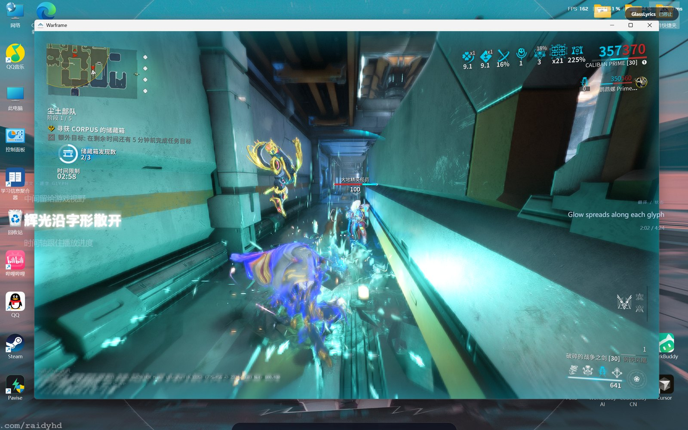
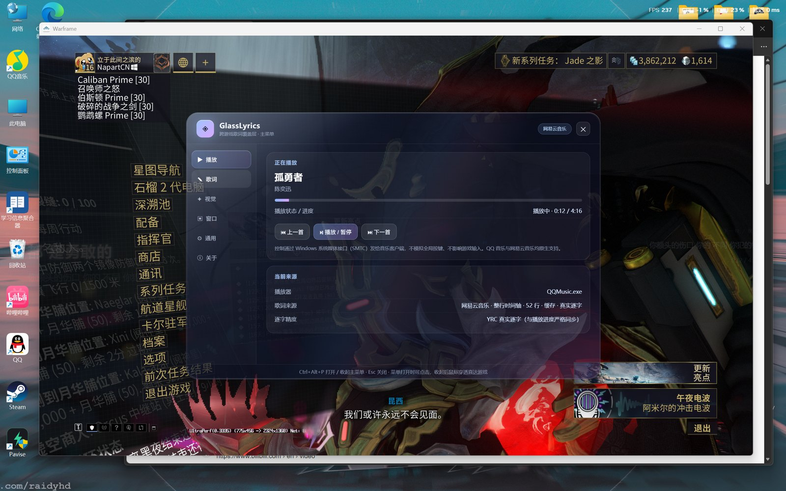

# GlassLyrics

在游戏画面上显示歌词。Windows / macOS / Linux。

程序开一个透明、置顶、鼠标穿透的窗口，歌词排在画面左右两侧，中间留给准星和视野。播放信息取自系统媒体接口（Windows SMTC、macOS AppleScript、Linux MPRIS），歌词取自各音乐平台的公开接口和 LRCLIB。不注入游戏进程，不读游戏内存，不采集音频。



下载：[Releases](https://github.com/Napart7/Music-and-game/releases)。
版本历史和每次改了什么在 [CHANGELOG.md](CHANGELOG.md)。

## 安装与使用

从 Releases 下载对应平台的产物：

| 平台 | 文件 |
|---|---|
| Windows | `GlassLyrics Setup x.y.z.exe`（安装版）、`GlassLyrics-Portable.exe`（免安装） |
| macOS | `GlassLyrics-x.y.z-arm64.dmg`（Apple 芯片）、`GlassLyrics-x.y.z.dmg`（Intel） |
| Linux | `GlassLyrics-x.y.z.AppImage`、`glasslyrics_x.y.z_amd64.deb` |

放一首歌，进游戏，歌词会自动出现。独占全屏（Exclusive Fullscreen）下任何普通置顶窗口都不可见，需要把游戏改成「无边框全屏」或窗口化全屏。

按 `Ctrl+Alt+P` 打开设置菜单。全部热键都能在「通用」页重绑定，播放控制热键默认为空。

| 默认热键 | 作用 |
|---|---|
| `Ctrl+Alt+P` | 打开 / 收起设置菜单 |
| `Ctrl+Alt+H` | 显示 / 隐藏歌词 |
| `Ctrl+Alt+B` | 切换布局 |
| `Ctrl+Alt+F` | 开关窗口跟随 |
| `Ctrl+Alt+PageUp` | 歌词提前 0.1 秒 |
| `Ctrl+Alt+PageDown` | 歌词延后 0.1 秒 |
| `Ctrl+Shift+Alt+Q` | 退出 |



## 支持的播放器

| 播放器 | 读取状态 / 播放控制 | 歌词来源 | 逐字时间轴 |
|---|---|---|---|
| QQ 音乐 | 支持 | QQ LRC，含翻译 | 按行推算 |
| 网易云音乐 | 支持 | 网易云 YRC，含翻译 | 原生逐字 |
| 酷狗音乐 | 支持 | 酷狗 LRC | 按行推算 |
| 汽水音乐 | 支持 | 同曲匹配 | 按行推算 |
| Apple Music | 支持 | 同曲匹配 + iTunes 元数据 | 按行推算 |
| Spotify | 支持 | 同曲匹配，LRCLIB 优先 | 按行推算 |

「同曲匹配」指用曲名和歌手去中文平台、LRCLIB 找同一首歌的歌词，不是该平台的官方歌词。界面会标出实际来源。汽水音乐、Apple Music、Spotify 没有公开歌词接口，只能用这条路径，冷门曲目可能找不到。

Spotify 的选歌搜索需要自备开发者凭据（developer.spotify.com 创建 App 后填进「通用」页），播放控制不需要。凭据只存在本机 `config.json`。

各平台的能力差异和边界写在 [docs/平台适配.md](docs/平台适配.md)。

## 平台支持

| | Windows 10/11 | macOS 12+ | Linux X11 | Linux Wayland |
|---|---|---|---|---|
| 读取状态 / 播放控制 | SMTC | Music、Spotify | MPRIS | MPRIS |
| 跟随游戏窗口 | Win32 | 需辅助功能权限 | xdotool | 受系统限制，退回整屏 |
| 透明置顶 / 全局热键 | 支持 | 支持 | 需合成器 | 取决于桌面环境 |
| 托盘 | 支持 | 支持 | 需 AppIndicator | 需 AppIndicator |

Linux 需要 `playerctl`（读歌/控播）、`xdotool` 和 `xprop`（窗口跟随）。Debian/Ubuntu：`sudo apt install playerctl xdotool x11-utils`。缺少时其余功能照常，只是不跟随窗口。macOS 首次运行需允许「辅助功能」和「自动化」权限；未签名版本要右键「打开」。

三端差异见 [docs/跨平台适配.md](docs/跨平台适配.md)。

## 可以调什么

歌词位置可以直接拖动（菜单「视觉」页点「自由拖动」），字号、字重、行距、侧栏宽度、不透明度、辉光颜色和强度都有滑块。逐字弹跳、字摆动、整句砸入、换行破碎飞散可以分别关掉；漂浮行数 3–6 行可调，也提供左右双侧 / 居中 / 单侧布局。

歌词时间轴有 ±3 秒的整体偏移，滑块和 `Ctrl+Alt+PageUp/PageDown` 都能调，切歌后保留。切出游戏时隐藏歌词、开机自启、窗口跟随都是开关。配置保存在本机，不上传。

低配设备可以打开「性能优先」：帧率上限 30、减少辉光层数、关闭字摆动。

## 常见问题

<details>
<summary>歌词和声音差半拍</summary>

蓝牙耳机、无线音箱、HDMI 接电视常有 100–300ms 音频延迟。游戏里按 `Ctrl+Alt+PageUp`（歌词提前）或 `Ctrl+Alt+PageDown`（歌词延后），每次 0.1 秒，屏幕下方会短暂显示当前偏移。也可以在「视觉」页拖滑块。
</details>

<details>
<summary>游戏里看不到歌词</summary>

先确认游戏不是独占全屏。如果是，改成无边框全屏。其次看 `Ctrl+Alt+H` 是否把覆盖层隐藏了。
</details>

<details>
<summary>切屏回来点不动游戏</summary>

覆盖层默认鼠标穿透。失焦、拖动模式退出、面板收起时都会重申穿透状态，还有 2 秒一次的检查兜底。若仍卡住，按 `Ctrl+Alt+H` 隐藏再显示一次。
</details>

<details>
<summary>会被反作弊检测吗</summary>

程序不注入、不挂钩子、不读写游戏内存，对游戏来说只是一层普通置顶窗口。带反作弊的联机游戏是否允许覆盖层，请自行确认。
</details>

更多排错见 [docs/使用说明.md](docs/使用说明.md)。

## 文档

- [使用说明](docs/使用说明.md)：安装、配置、排错
- [更新说明](docs/更新说明-v1.4.md)：功能清单与平台能力矩阵
- [CHANGELOG](CHANGELOG.md)：版本历史
- [技术方案](docs/技术方案.md)：渲染管线、逐字时间轴、窗口贴合
- [性能基准](docs/性能自检-v1.3.md)：帧时间与歌词连接延迟的测量方法
- [第三方声明](docs/第三方声明.md)：数据来源与使用边界
- [CONTRIBUTING](CONTRIBUTING.md)：本地跑法、回归清单、发版约定

## 实现概要

- 主进程（`app/main.js`）管窗口、全局热键、托盘、配置和前台窗口跟随。
- 平台后端（`app/backends/` 与几个 `.ps1` / `.sh` 脚本）负责读曲目、进度、状态，以及播放控制。
- 歌词引擎（`app/lyrics.js`、`app/providers.js`）按播放器排源顺序，竞速请求，结果缓存在本机，最多 300 条。
- 渲染层（`app/renderer/index.html`，单文件）负责逐字扫光、字形辉光、漂浮歌词和设置菜单。播放位置由 `app/playback-clock.js` 按本地单调时钟推算，不依赖逐帧 IPC。
- 运行时依赖只有 Electron 本体，`dependencies` 为空。

渲染和性能的具体取舍写在 [docs/性能自检-v1.3.md](docs/性能自检-v1.3.md) 和代码注释里。

## 开发与构建

```bash
cd app
npm install
npm start          # 开发运行
npm run dist       # 打包到 ../dist
```

回归测试不需要打包，用无头 Chrome/Edge + CDP 跑，共 330 项：

```bash
node tools/check_compliance.mjs   # 发布门禁 44 项：文件 / 敏感信息 / 语法 / 换行符 / changelog 同步
node tools/verify_classify.mjs    # 51 项：窗口分类
node tools/verify_backends.mjs    # 41 项：三端后端、时间轴、SMTC 状态枚举与自愈
node tools/verify_providers.mjs   # 36 项：歌词源解析、清洗、平台识别
node tools/verify_lyrics.mjs      # 24 项：歌词引擎、时间轴推进、热路径
node tools/verify_menu.mjs        # 61 项：菜单、辉光、热键、拖动、漂浮
node tools/verify_autofit.mjs     # 22 项：窗口自适应
node tools/verify_preview.mjs     # 29 项：视觉预览页
node tools/verify_tray_panel.mjs  # 10 项：常驻托盘面板 IPC
node tools/verify_shatter.mjs     # 12 项：换行破碎飞散

node tools/bench_perf.mjs         # 9 场景帧时间基准
node tools/bench_longrun.mjs      # 加速长跑：帧时间 / 堆 / DOM / 监听器随时间的变化
node tools/bench_lyrics.mjs       # 真实网络的歌词连接延迟
node tools/gen_changelog.mjs      # 改完 CHANGELOG.md 后生成 app/changelog.json
```

发版：改 `app/package.json` 版本号 → 跑 `gen_changelog.mjs` → `git tag vX.Y.Z` → push tag，GitHub Actions 构建三平台产物并发布 Release。

改完源码想让本机已安装的版本立刻生效，不用等 Release：

```bash
node tools/patch_installed.cjs             # Windows 默认 D:\软件\GlassLyrics
node tools/patch_installed.cjs <安装目录>  # 或显式指定
```

它按 `build.files` 重新打包 `resources/app.asar`、备份旧包，并同步 asar 外的 PowerShell 桥接与 backends 脚本。执行完重启应用即可；脚本不会结束正在运行的进程。

## 目录结构

```
app/
  main.js            主进程：窗口、热键、托盘、跟随、点击穿透、IPC
  lyrics.js          歌词引擎：竞速、缓存、降级
  providers.js       QQ / 网易云 / 酷狗 / LRCLIB / iTunes / Spotify
  playback-clock.js  播放位置推算（主进程与渲染层共用）
  preload.js         渲染层 IPC 桥
  tray-panel.html    常驻托盘面板
  backends/          平台后端与统一解析
  renderer/          渲染层（单文件）
  *.ps1              Windows 侧 SMTC、播放控制、窗口探针
docs/                文档、实机截图、基准数据
tools/               回归、基准、门禁、构建素材
```

## 数据来源与边界

- 播放状态来自系统媒体接口；歌词文本在运行时从公开接口获取，只缓存在用户本机。仓库和安装包不含歌词数据。
- 不注入进程、不读游戏内存、不模拟全局按键、不抓音频、不破解加密歌词、不下载歌曲、不绕过 DRM。
- 视觉参数参考 DangoMusic（GPL-3.0）公开的渲染规格描述，未使用其代码、着色器或素材。
- Spotify 凭据由用户自备，仅存本机。

详见 [docs/第三方声明.md](docs/第三方声明.md)。

## License

[MIT](LICENSE) © GlassLyrics contributors
